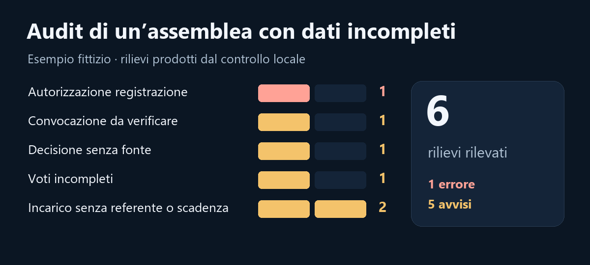
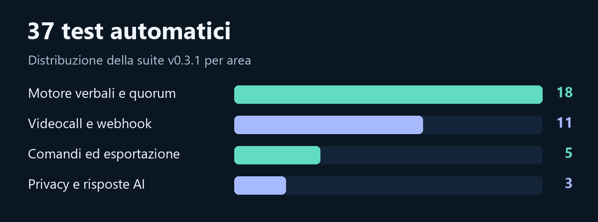

# Verbalia Open

**Verbali di riunione con voti, fonti e controlli ripetibili.** Una skill open source per assemblee condominiali, CDA, riunioni di lavoro, cantieri e associazioni.

[](https://github.com/lupogno/verbalia-open/actions/workflows/ci.yml) [](LICENSE) [](https://github.com/lupogno/verbalia-open/releases/latest)

[**Scarica la skill**](https://github.com/lupogno/verbalia-open/releases/latest) · [**Guarda la demo**](#demo-unassemblea-da-verificare) · [**Leggi il confronto**](#quando-scegliere-verbalia-open) · [**Prova in locale**](#prova-in-locale-senza-api)

## Demo: un’assemblea da verificare

Negli appunti dell’assemblea i lavori straordinari risultano approvati. Nel dossier manca però il voto di un avente diritto presente e la decisione è priva di una fonte associata. Verbalia conserva l’esito dichiarato, segnala le lacune e lascia il calcolo delle soglie in sospeso.



Il grafico riproduce il risultato di `verbalia validate examples/caso_critico.json --json`. L’errore relativo all’autorizzazione della registrazione fa terminare il comando con codice `1`. [Dossier fittizio](examples/caso_critico.json)

Per vedere il risultato completo di un secondo esempio, apri [verbale in bozza](demo/verbale-condominio.md), [sintesi](demo/sintesi-condominio.md), [audit JSON](demo/audit-condominio.json) e [registro azioni CSV](demo/azioni-condominio.csv).

## Quando scegliere Verbalia Open

| Se ti serve | Cosa offre Verbalia Open |
|---|---|
| Ricostruire una delibera | Collega i punti dell’ordine del giorno a fonti, presenze, deleghe e voti nominali. Per i profili implementati, verifica le soglie numeriche sulla regola indicata. |
| Individuare cosa manca | Consegna un audit con riferimenti ai campi da completare. Voti incompleti e regole da qualificare lasciano il controllo delle soglie in sospeso. |
| Tenere i dati sul tuo computer | Dal dossier JSON ottieni audit e documenti in locale. L’uso delle API per AI e videocall richiede attivazione esplicita. |
| Adattare il flusso al tuo studio | Codice e modelli MIT, schema JSON e skill portabile per agenti compatibili. Puoi ispezionare le regole e rieseguire i controlli sui tuoi dati. |

**Rispetto agli strumenti per le videocall**, Fireflies, Otter e MeetGeek documentano funzioni di trascrizione e sintesi, ricerca o highlight. Verbalia è pensato per il passaggio successivo, quando serve ricostruire la decisione nel verbale e indicare quali dati mancano. [Fireflies](https://guide.fireflies.ai/articles/9547055509-fireflies-ai-meeting-summaries) · [Otter](https://otter.ai/) · [MeetGeek](https://support.meetgeek.ai/en/articles/6021900-highlights-summaries)

**Nel condominio**, VerbaliAI presenta la verbalizzazione dentro un gestionale, CondominioDoc AI offre anche ricerca giurisprudenziale e calcolatori, mentre Verbale.online mostra bozze con voti e millesimi. Il vantaggio di Verbalia Open emerge quando servono codice ispezionabile, verifica locale ripetibile e un audit esportabile, anche per CDA e altri tipi di riunione. [VerbaliAI](https://verbaliai.it/) · [CondominioDoc AI](https://condominiodoc.ai/) · [Verbale.online](https://verbale.online/)

[Confronto per singolo strumento e metodo](docs/COMPARATIVA.md)

## Test e risultati



Tutti i **37 test della v0.3.1** passano su Python **3.10, 3.12, 3.13 e 3.14**. Tra i casi verificati ci sono voti duplicati, soglie insufficienti, decisioni senza fonti, trascrizione senza conferma ed eventi webhook con firma errata. Per la videocall si usano API simulate. [Esecuzione su GitHub Actions](https://github.com/lupogno/verbalia-open/actions/runs/43591819967) · [Codice dei test](tests/)

<details>
<summary>Esegui i test sul tuo computer</summary>

```bash
python -m pip install -e .
python -m unittest discover -s tests -v
python tools/check_repo.py
```

</details>

## Prova in locale senza API

```bash
# Da Python 3.10+
python -m pip install -e .
verbalia validate examples/condominio.json
verbalia bundle examples/condominio.json --out output/demo
verbalia render examples/condominio.json --format md --out output/demo/verbale.md
```

Esegui i comandi dalla cartella del repository. Trovi bozza, sintesi, audit e registro azioni in `output/demo`.

## Verbalia Live in videocall

Puoi invitare un **assistente visibile** in una riunione su Meet, Zoom, Teams o Webex tramite Recall.ai. L'host lo ammette quando la piattaforma lo richiede. Il bot entra con l'acquisizione disattivata. Avvia la trascrizione quando hai informato i presenti e verificato la base giuridica e gli eventuali consensi. I test automatici usano API simulate. L'ingresso e la trascrizione su videocall reali sono da collaudare.

```bash
export RECALL_REGION=eu-central-1
export RECALL_API_KEY='CHIAVE_REALE_DA_OTTENERE_DAL_FORNITORE'
verbalia live join 'https://meet.google.com/abc-defg-hij' --allow-external-processing --participants-informed
verbalia live status UUID_BOT
verbalia live start UUID_BOT --language it --allow-external-processing --participants-informed
verbalia live stop UUID_BOT
verbalia live leave UUID_BOT --confirm-leave
```

Per aggiornare una trascrizione durante la riunione, occorre **anche** un ricevitore webhook con segreto di firma e endpoint HTTPS pubblico. Vedi [guida Verbalia Live](docs/MEETING_LIVE.md). In italiano la trascrizione live può arrivare con diversi minuti di ritardo. Recall.ai è un servizio esterno con proprie condizioni e costi.

## Word, PDF e interfaccia grafica

```bash
python -m pip install -e '.[documents,ui]'
verbalia render examples/condominio.json --format docx --out output/verbale.docx
verbalia render examples/condominio.json --format pdf --out output/verbale.pdf
streamlit run src/verbalia_open/ui.py --server.address 127.0.0.1
```

Le esportazioni sono **di base** (il Word non conserva ancora tutte le tabelle come tabelle native). Utilizzare una revisione visiva prima di inviare documenti.

## Bozza da appunti con AI

```bash
python -m pip install -e '.[ai]'
export OPENAI_API_KEY="<chiave_api_personale>"
verbalia ai-draft examples/appunti_condominio.txt --type condominio --model MODELLO_DISPONIBILE --out output/estrazione.json --allow-external-processing
verbalia validate output/estrazione.json
verbalia bundle output/estrazione.json --out output/riunione
```

Scegli un modello disponibile nel tuo account API. `--allow-external-processing` **non sostituisce** l'informativa, la base giuridica, gli eventuali consensi, la scelta del responsabile del trattamento e le tutele contrattuali necessarie. Per l'audio: `verbalia transcribe audio.mp3 --model gpt-4o-transcribe --out note.txt --allow-external-processing`.

**Nessuna chiave API è presente nel repository. Non committare verbali veri, audio o dati personali su GitHub.**

## Utilizzo come Skill con ChatGPT, Codex, Claude e altri agenti

È una cartella nel formato [Agent Skills](https://agentskills.io/). In un agente che supporta skills puoi aggiungere la cartella del repository come skill e far leggere `SKILL.md`. **La semplice presenza su GitHub non installa automaticamente la skill in ogni ChatGPT**; percorso/installazione dipendono dal client.

Per un GPT personalizzato senza caricamento skill da filesystem puoi utilizzare le istruzioni di `SKILL.md` come base del comportamento, allegando i modelli. Per avere *esecuzione di script*, l'ambiente deve supportarla.

## Revisione e documentazione

L’approvazione spetta alle persone autorizzate. L’esito dichiarato resta distinto dalla verifica numerica, che dipende dai dati e dal profilo di quorum selezionato. [Quorum](docs/QUORUM.md) · [Fonti normative](docs/FONTI_NORMATIVE.md) · [Privacy e GDPR](docs/PRIVACY_GDPR.md)

[Istruzioni della skill](SKILL.md) · [Modelli](assets/templates/) · [Schema dati](schemas/meeting.schema.json) · [Esempi](examples/) · [Roadmap](docs/ROADMAP.md)

[Licenza MIT](LICENSE) · [Contribuisci](CONTRIBUTING.md) · [Sicurezza](SECURITY.md) · [Guida alla pubblicazione](docs/PUBBLICAZIONE_GITHUB.md)
