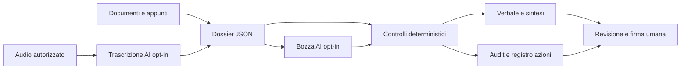
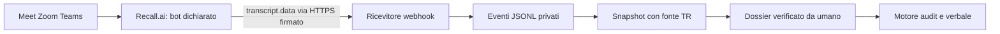

# Architettura modulare

## Videocall (v0.3, opt-in)

Non esiste un join nativo dentro il solo prompt: è necessario il servizio esterno, l'host della videocall, le relative autorizzazioni e un backend HTTPS per eventi realtime. Il ricevitore verifica HMAC e lista UUID autorizzati; non è ancora un'infrastruttura SaaS pronta per produzione.

## Local-first

`engine.py` contiene soglie aritmetiche, coerenza e validazione preliminare; `render.py` produce Markdown, JSON e CSV. Senza dipendenze esterne il prodotto è offline.

## Opt-in esterno

`ai.py` richiede il client OpenAI e flag esplicito. Usa Responses API per testo e Audio API per trascrizione, con modello scelto dall'operatore. `store=False` è una richiesta di non memorizzazione delle risposte lato API ove supportata, **non una dichiarazione completa sulle politiche di trattamento o conservazione del provider**.

## Estensioni

`exporters.py` genera DOCX e PDF di base; `ui.py` è un'interfaccia locale Streamlit. Per SaaS occorrono autenticazione, autorizzazioni, storage cifrato, tenant separation, audit append-only, retention, DPA, certificazioni e test di sicurezza indipendenti.
